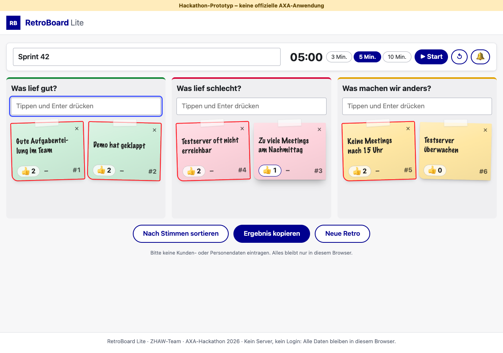
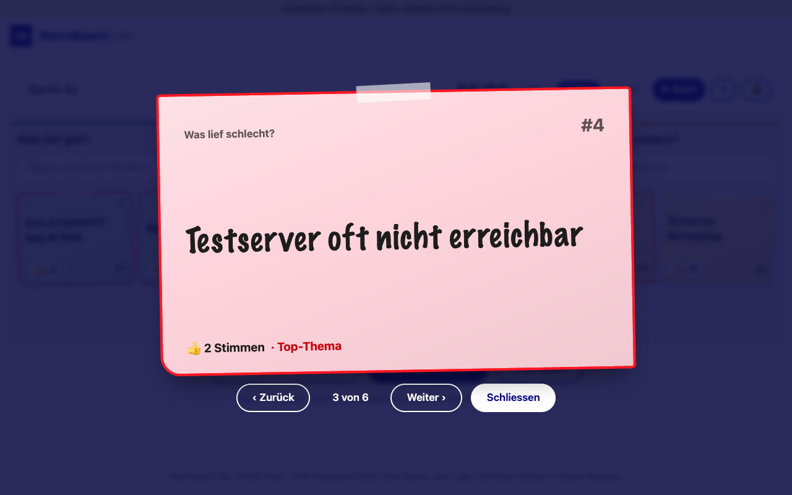

# RetroBoard Lite

> **Hackathon prototype – not an official AXA application.**

A digital sticky-note wall for sprint retrospectives. Built at the AXA hackathon (10/11 November 2026) as an
example mini app for **«AXA Mini Apps – Citizen Development Boost Factory» («AXA LOS!»)**: employees build
small, useful apps themselves — fast and with AI assistance, but within clear guardrails.

**Live:** https://ganemmah.github.io/axa-miniapp-retrolos/



## Problem

Scrum teams look back on every sprint in a **retrospective**: what went well, what did not, what do we change?
Working remotely, the wall with the sticky notes is missing. Many teams therefore use external online tools,
and internal topics end up with third-party providers — classic **shadow IT**.

## Solution

One page, three columns. The person moderating shares the screen in the Teams call:

1. **Optional:** enter a title (e.g. «Sprint 42») and start the **timer** — 3, 5 or 10 minutes. A soft gong
   sounds at the end (switch off with 🔕).
2. **Write notes:** type into a column and press Enter — «Was lief gut?», «Was lief schlecht?», «Was machen wir
   anders?». Every note gets a fixed number (#1, #2 …) to refer to while moderating.
3. **Vote:** click 👍 (and «−» to take a vote back). Notes stay where they are while voting; the top topic of
   each column gets a red frame. **«Nach Stimmen sortieren»** puts the most important notes first when the
   moderator wants it.
4. **Discuss:** click a note to show it **large** — ideal for the projector. Browse with ‹ › or the arrow keys,
   close with Esc.
5. **Share:** **«Ergebnis kopieren»** copies the result as text for Teams or an e-mail, sorted by votes.
6. **«Neue Retro»** clears the board for next time.

Everything is saved automatically in the browser; nothing is lost on a reload. The design follows the colours
and shapes of axa.ch (without the AXA logo) and has a dark mode.



## Guardrails

- **No personal or customer data.** No login, no names. A notice in the app reminds users.
- **No server, no network access.** The retro stays in the browser. The Content-Security-Policy
  `default-src 'self'` prevents the page from loading anything from elsewhere or sending anything away.
- **No dependencies, no build.** HTML, CSS, vanilla JavaScript; the repository root is the website.
- **Works by double-click.** `index.html` opens straight from disk (classic deferred scripts, no ES modules).
- **Renders without JavaScript.** The structure is plain HTML; JavaScript only adds the operations.
- **Checked automatically.** [`tests/guardrails.test.js`](tests/guardrails.test.js) checks the CSP, script
  loading, relative paths, external URLs, network calls, HTML strings, colour tokens, dark mode, and the
  mini-app profile. **Nothing is deployed unless all tests pass.**
- **Mini-app profile [`miniapp.json`](miniapp.json):** purpose, owner role and deputy, risk level with «rises
  when …», next review date, data classification, network access, hosting. A platform could build a **catalogue
  of all mini apps** from these files and check automatically which approval an app needs.

## Next stages

Each extension that shares or forwards data changes the profile, and with it the review needed:

| Extension | What changes |
|---|---|
| Everyone writes at the same time from their own device | Needs shared storage — target picture: a Teams app with **Live Share**, data in the AXA tenant → risk level medium, security review |
| Export straight to Jira or Confluence | Network access to internal systems → interface review |
| AI summarises the notes | Texts go to an AI service → only with AXA-internal AI, AI governance |

## Run locally

Double-click `index.html`. That is all — no install, no server.

Tests (Node.js 22 or newer, no `npm install`):

```bash
node --test
```

## Deploy

`.github/workflows/deploy.yml` runs on every push to `main`: tests first, then the repository root is
published to GitHub Pages. One-time setup: **Settings → Pages → Build and deployment → Source = GitHub
Actions**.

## Project structure

```
index.html                    page structure (works without JavaScript)
styles.css                    tokens, layout, dark mode
retro-core.js                 pure logic: settings, board, votes, summary, timer
app.js                        operations on the page: notes, voting, timer, gong, zoom, copy, storage
favicon.svg
miniapp.json                  mini-app profile (governance proposal)
AGENTS.md                     conventions, guardrails, decisions (source of truth for humans and AI)
CLAUDE.md                     points to AGENTS.md
specs/_template/spec.md       spec template
specs/001-retro-board/spec.md user stories and acceptance criteria
tests/                        node --test
docs/                         user guide, demo script, screenshots
.github/workflows/deploy.yml  test, then publish to GitHub Pages
```

**Rename a column, change a limit or a timer duration:** settings at the top of
[`retro-core.js`](retro-core.js); column titles also live in `index.html` (a test checks they match).

## Limits of the prototype

- One person operates the app; the team watches the shared screen.
- No sync between devices or browsers.
- Data lies unencrypted in the browser; «Neue Retro» deletes it.

## More

- [`docs/usage.md`](docs/usage.md) — user guide
- [`docs/demo-script.md`](docs/demo-script.md) — the 3-minute demo
- [`AGENTS.md`](AGENTS.md) — conventions and all decisions

Based on the team template [ulricst3/AXA_HackathonTemplate](https://github.com/ulricst3/AXA_HackathonTemplate).
ZHAW team, business information systems, AXA hackathon 2026.
